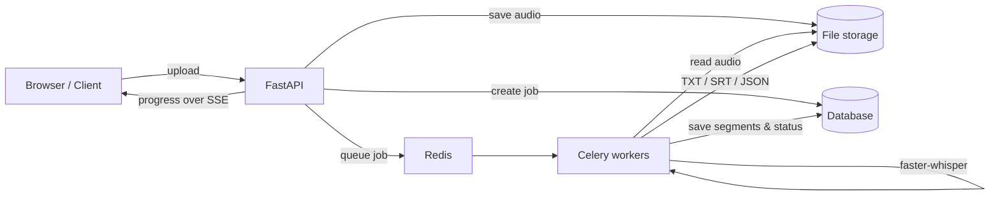

# Volga: Audio Transcription Service

Volga turns audio files into timestamped transcripts. You upload a recording and get back text split into segments, each with a start time, an end time and a confidence score. Transcripts can be downloaded as **TXT**, **SRT** or **JSON**.

It runs as a web app with a REST API, and also as a command-line tool. Transcription uses **faster-whisper** on the CPU.

---

## How it works



1. **Upload.** The API checks the file type and size, and uses `ffprobe` to confirm it contains real audio. It then saves the file, creates a job and replies with **`202 Accepted`** and a job ID. The API itself never transcribes anything.
2. **Queue.** The job is placed in **Redis**, and **Celery** workers pick jobs up one at a time. Each worker loads the Whisper model once and reuses it for every job.
3. **Normalize.** Every input is converted with FFmpeg to **16 kHz mono WAV**, so the model always receives the same kind of audio.
4. **Chunk long files.** Recordings over 10 minutes are split into 5-minute chunks with 3 seconds of overlap. Each chunk is its own task. Timestamps are shifted back to their place in the full recording, and every overlap belongs to exactly one chunk, so no words are repeated at the seams.
5. **Save as you go.** Each chunk's segments are written to the database as soon as that chunk finishes. Once every chunk is done, the transcript is assembled and exported.
6. **Track progress.** The browser receives live status and progress through **Server-Sent Events** (SSE), and falls back to polling if SSE isn't available.

## Reliability

- **Retries.** Temporary errors are retried with exponential backoff. Permanent errors, such as corrupt audio, fail immediately.
- **Partial retry.** If a job fails, `POST /retry` reprocesses only the failed chunks.
- **Crash recovery.** If a worker dies, Redis hands its task to another worker. On startup, each worker re-queues stuck chunks and jobs.
- **Safe duplicates.** The database is the source of truth. Status changes are atomic, and a claim token on each chunk means a task delivered twice can't save its results twice.
- **Cancel.** Cancelling a job stops it from starting any new chunks.

## Storage

- **Audio files** are saved under a generated name, never the user's filename, at `storage/files/audio/<user>/<job_id>/`.
- **Exported transcripts** go to `storage/files/transcripts/<user>/<job_id>/`.
- **The database** holds only jobs, chunks and segments, never audio. It is SQLite by default, or PostgreSQL if you set `DATABASE_URL`.
- **Cleanup.** Old jobs are deleted after `RETENTION_DAYS` (30 by default) when you run `python manage.py cleanup`.

---

## API

| Method & path | What it does |
|---|---|
| `POST /api/v1/transcriptions` | Upload audio (form field `audio_file`) and return `202` with a `job_id` |
| `GET /api/v1/transcriptions/{id}` | Job status, progress and any error |
| `GET /api/v1/transcriptions/{id}/events` | Live progress stream (SSE) |
| `GET /api/v1/transcriptions/{id}/result` | Transcript text and segments |
| `GET /api/v1/transcriptions/{id}/result/{txt\|srt\|json}` | Download the transcript as a file |
| `POST /api/v1/transcriptions/{id}/retry` | Retry the failed chunks |
| `DELETE /api/v1/transcriptions/{id}` | Cancel the job |
| `GET /api/v1/health` | Database and Redis health |

Errors are returned as `{"error": {"code": "...", "message": "..."}}` with these status codes:

| Code | Meaning |
|---|---|
| `400` | No file, or the file is empty |
| `413` | File is too large |
| `415` | Unsupported format |
| `422` | Corrupt audio |
| `409` | The job isn't in the right state for this action |
| `503` | The queue is unavailable |

Supported formats: **WAV, MP3, M4A, FLAC and OGG**.

---

## Running it

You need Python 3.12, FFmpeg and Redis. On Windows, run Redis through WSL, Memurai or Docker.

```bash
pip install -r requirements.txt
cp .env.example .env

uvicorn app:app --port 8000                                   # API + web UI
celery -A workers.celery_app worker --loglevel=INFO --pool=solo   # worker (second terminal)
```

Open `http://127.0.0.1:8000`. To transcribe more jobs at once, start more workers: `-n worker2@%h`, `-n worker3@%h` and so on.

**CLI, without Redis or workers:**

```bash
python -m transcribe_pipeline.cli transcribe audio.mp3 --out-dir out/
```

**Tests:**

```bash
pytest tests/
```

Live Redis tests are skipped automatically if Redis isn't running.

### Key settings (`.env`)

| Variable | Default | Purpose |
|---|---|---|
| `REDIS_URL` | `redis://localhost:6379/0` | Celery broker |
| `DATABASE_URL` | *(empty, uses SQLite)* | Database connection string, e.g. `postgresql+psycopg://...` |
| `WHISPER_MODEL` | `base` | Whisper model size |
| `CELERY_CONCURRENCY` | `1` | Transcriptions per worker |
| `CHUNKING_THRESHOLD` | `600` | Files longer than this many seconds are chunked |
| `MAX_UPLOAD_SIZE_MB` | `500` | Upload size limit |
| `RETENTION_DAYS` | `30` | How long jobs are kept |

---

## Project layout

```
api/                  REST routes (/api/v1/transcriptions, health) and error format
workers/              Celery app and tasks (transcribe, chunk, finalize, recover, cleanup)
services/             Job state changes, engine loading, error classification
chunking/             Splitting long audio and merging chunk results
transcribe_pipeline/  Validation, FFmpeg normalization, Whisper engine, exporters, CLI
database/             SQLAlchemy models (jobs, chunks, segments) and session
filestore/            File storage (local)
templates/index.html  Web UI
app.py                FastAPI entry point
manage.py             init-db | recover | cleanup | status
```
